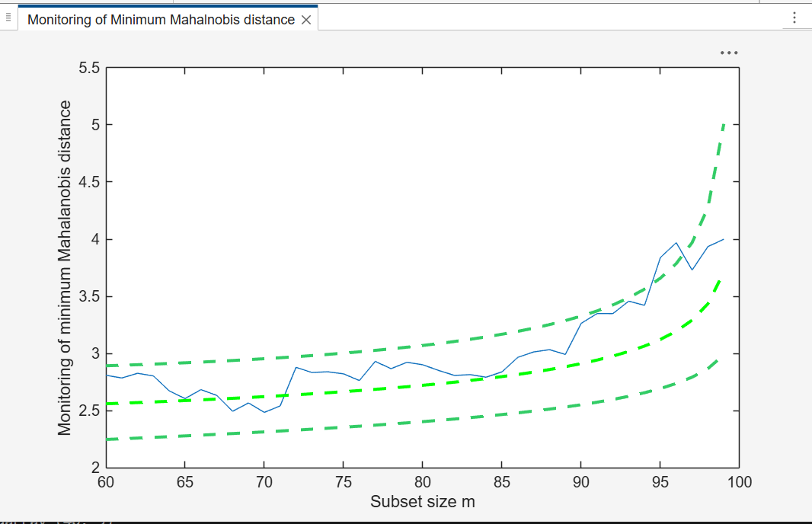

# FSMeda

FSMeda performs forward search in multivariate analysis with exploratory data analysis purposes.

## Input arguments

Mandatory:

| Argument | Type | Description |
|---|---|---|
| `Y` | `ndarray`, `n x v` | input data: `n` observations and `v` variables. Rows are observations, columns are variables. `NaN`/`Inf` rows are excluded automatically. |
| `bsb` | `ndarray` | list of units forming the initial subset. If `bsb=0` (default), the procedure starts with `v` units randomly chosen; otherwise the search starts with `m0=length(bsb)`. Units are numbered from 1 (MATLAB convention). |

Optional, passed as keyword arguments:

| Argument | Default | Description |
|---|---|---|
| `init` | `floor(n*0.6)` | point where to start monitoring the required diagnostics. If `bsb` is supplied, `init >= length(bsb)` |
| `plots` | `0` (all plots suppressed) | `1` draws the monitoring of the minimum Mahalanobis distance among the units not belonging to the subset, with 1 per cent, 50 per cent and 99 per cent confidence bands |
| `msg` | `1` | `1` displays messages about great interchange on the screen, otherwise no message is displayed |
| `scaled` | `0` (distances are not scaled) | `1` scales the Mahalanobis distances monitored during the search using the ratio of determinants; `2` scales them using the asymptotic consistency factor |
| `nocheck` | `0` | `1` performs no check on matrix `Y` |


## Example

Monitoring the evolution of the minimum Mahalanobis distance.

```python
import numpy as np
import pyfsda

eng = pyfsda.start(check_version=False)

np.random.seed(123456)
n = 100
v = 3
m0 = 3
Y = np.random.randn(n, v)

# Contaminated data
Ycont = Y.copy()
Ycont[0:5, :] = Ycont[0:5, :] + 3.0

# Initial subset: the m0 units with the lowest Mahalanobis distance
fre = np.asarray(pyfsda.unibiv(Y))
order = np.argsort(fre[:, 3], kind="stable")
bs = fre[order[:m0], 0].reshape(-1, 1)

out = pyfsda.FSMeda(Ycont, bs, plots=1)

pyfsda.stop()
```

Console Output:

```
Warning: Matrix is close to singular or badly scaled. Results may be inaccurate. RCOND =  8.396106e-18.
> In FSMeda (line 590)

MAL ndarray (100, 41)
BB ndarray (100, 41)
msr ndarray (41, 3)
mmd ndarray (40, 3)
gap ndarray (40, 3)
S2cov ndarray (41, 7)
detS ndarray (41, 3)
Un ndarray (40, 11)
Y ndarray (100, 3)
Loc ndarray (41, 4)
class str None
```



## Output

A `dict` keyed by the FSDA field names:

| Field | Description |
|---|---|
| `MAL` | `n x (n-init+1)` matrix with the monitoring of the Mahalanobis distances. 1st row = distance for the first unit; ...; `n`th row = distance for the `n`th unit |
| `BB` | `n x (n-init+1)` matrix with the information about the units belonging to the subset at each step of the forward search. 1st column = indexes of the units forming the subset in the initial step; ...; last column = units forming the subset in the final step (all units) |
| `mmd` | `(n-init) x 3` matrix with the monitoring of the minimum MD or `(m+1)`th ordered MD at each step of the forward search. 1st column = forward search index (from `init` to `n-1`); 2nd column = minimum MD; 3rd column = `(m+1)`th-ordered MD |
| `msr` | `(n-init+1) x 3` matrix with the monitoring of the maximum MD or `m`th ordered MD. 1st column = forward search index (from `init` to `n`); 2nd column = maximum MD; 3rd column = `m`th-ordered MD |
| `gap` | `(n-init) x 3` matrix with the monitoring of the gap (difference between the minimum MD outside the subset and the maximum inside). 1st column = forward search index; 2nd column = min MD - max MD; 3rd column = `(m+1)`th ordered MD - `m`th ordered distance |
| `Loc` | `(n-init+1) x (v+1)` matrix with the monitoring of the estimated means of each variable at each step of the forward search |
| `S2cov` | `(n-init+1) x (v*(v+1)/2+1)` matrix with the monitoring of the elements of the covariance matrix at each step of the forward search. 1st column = forward search index (from `init` to `n`); 2nd column = monitoring of `S(1,1)`; 3rd column = `S(1,2)`; ...; last column = `S(v,v)` |
| `detS` | `(n-init+1) x 3` matrix with the monitoring of the determinant of the covariance matrix at each step of the forward search |
| `Un` | `(n-init) x 11` matrix with the unit(s) included in the subset at each step of the forward search. At every step the new subset is compared with the old one: `Un` contains the unit(s) present in the new subset but not in the old one |
| `Y` | original data input matrix |
| `class` | `'FSMeda'` |

## See also

- FSMeda documentation: <https://rosa.unipr.it/FSDA/FSMeda.html>
- FSDA datasets information: <https://rosa.unipr.it/FSDA/datasets_mv.html>