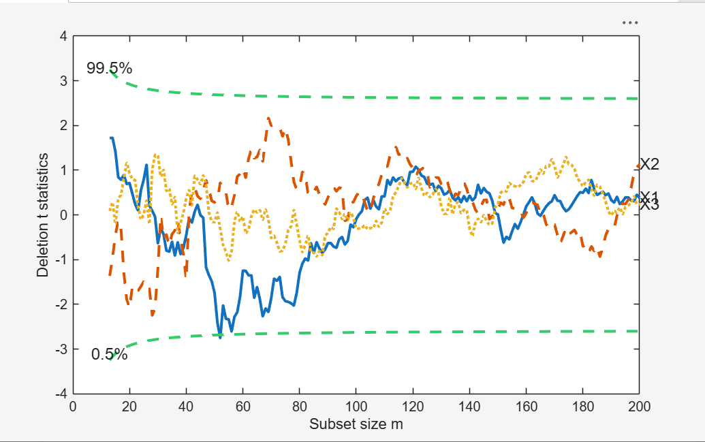

# FSRaddt

FSRaddt produces t deletion tests for each explanatory variable.

## Input arguments

Mandatory:

| Argument | Type | Description |
|---|---|---|
| `y` | `ndarray`, length `n` | response variable, either a row or a column vector. `NaN`/`Inf` rows are excluded automatically. |
| `X` | `ndarray`, `n x (p-1)` | explanatory variables (regressors). Rows are observations, columns are variables. `NaN`/`Inf` rows are excluded automatically. |

Optional, passed as keyword arguments (the most commonly used ones -- see the
full list on RoSA, linked below, for the rest):

| Argument | Default | Description |
|---|---|---|
| `DataVars` | [] | columns of `X` for which the t deletion tests are computed (vector of positive integers) |
| `h` || number of observations that have determined the least trimmed squares estimator; an integer greater or equal than `[(n+size(X,2)+1)/2]` and smaller than `n` |
| `ilr` | `False` | set to `True` if `X` contains compositional data: for each column of `X` the function `pivotCoord` is invoked and the added variable whose test is monitored is the first coordinate of the ilr transformation |
| `intercept` | `True` | `True` includes the constant term in the fit, `False` removes it from the model |
| `init` | `p+1` if `n<40`, else `min(3p+1, floor(0.5(n+p+1)))` | initial subset size at which monitoring starts|
| `lms` | `1` | `1` computes Least Median of Squares to find the initial subset, any other value computes Least Trimmed Squares |
| `nsamp` | all subsets if fewer than 1000 are possible, else 1000 | number of subsamples extracted to find the robust estimator; `0` extracts all  |
| `plots` | 0 | `1` draws a plot with the forward deletion t statistics |
| `nameX` | `X1, ..., Xp`  | labels of the variables of the regression dataset, used in the plot |
| `lwdenv` | `2` | line width for the envelopes based on the Student T |
| `msg` | `True` | `True` displays messages about the subset size every 100 steps, otherwise no message is displayed |
| `quant` | `[0.005, 0.995]` | confidence quantiles for the envelopes of the deletion t statistic (a 99 per cent pointwise confidence interval) |
| `lwdt` | `2` | line width for the deletion t statistic |
| `nocheck` | `False` | `True` performs no check on `y` and `X`, which are left unchanged: the column of ones for the intercept is not added |
| `titl` | `''` | label for the title |
| `labx` | `'Subset size m'` | label for the x-axis |
| `laby` | `'Deletion t statistics'` | label for the y-axis |
| `FontSize` | `12` | font size of the labels of the axes and of the labels inside the plot |
| `SizeAxesNum` | `10` | size of the numbers of the axes |
| `ylimy` | `''` (automatic scale) | minimum and maximum of the y axis |
| `xlimx` | `''` (automatic scale) | minimum and maximum of the x axis |

## Example


FSRaddt with all default options.

```python
import numpy as np
import pyfsda

eng = pyfsda.start(check_version=False)

np.random.seed(123456)
n = 200
p = 3
X = np.random.randn(n, p)
y = np.random.randn(n, 1)

out = pyfsda.FSRaddt(y, X)

pyfsda.stop()
```



## Output

A `dict` keyed by the FSDA field names:

| Field | Description |
|---|---|
| `Tdel` | `(n-init+1) x (p+1)` matrix with the monitoring of the deletion t statistic at each step of the forward search. 1st column = forward search index (from `init` to `n`); 2nd column = deletion t statistic for the first explanatory variable; 3rd column = for the second explanatory variable; ...; `(p+1)`th column = for the `p`th explanatory variable |
| `S2del` | `(n-init+1) x (p+1)` matrix with the monitoring of the deletion S2 statistic at each step of the forward search. 1st column = forward search index; the other columns = estimate of sigma^2 when the ordering of the units entering the search is found excluding the first, second, ..., last explanatory variable |
| `bs` | `p x length(DataVars)` matrix with the units forming the initial subset of length `p` for the searches associated with the deletion t statistics |
| `Un` | cell of length `length(DataVars)` (a `list` in Python). `Un[i]` is an `(n-init) x 11` matrix with the unit(s) included in the subset at each step of the search which excludes the `i`th explanatory variable. At every step the new subset is compared with the old one: `Un` contains the unit(s) present in the new subset but not in the old one |
| `y` | vector with the response variable that has been used |
| `X` | matrix of explanatory variables that has been used (it also contains the column of ones if the option `intercept` was missing or equal to `True`) |
| `la` | vector with the numbers of the columns of `out["X"]` for which the deletion t statistics have been computed. For example, if the intercept is present and `DataVars` was `[1, 3]`, then `la = [2, 4]` |
| `class` | `'FSRaddt'` |

## See also

- FSRaddt documentation: <https://rosa.unipr.it/FSDA/FSR.html>
- FSDA datasets information: <https://rosa.unipr.it/FSDA/datasets_reg.html>