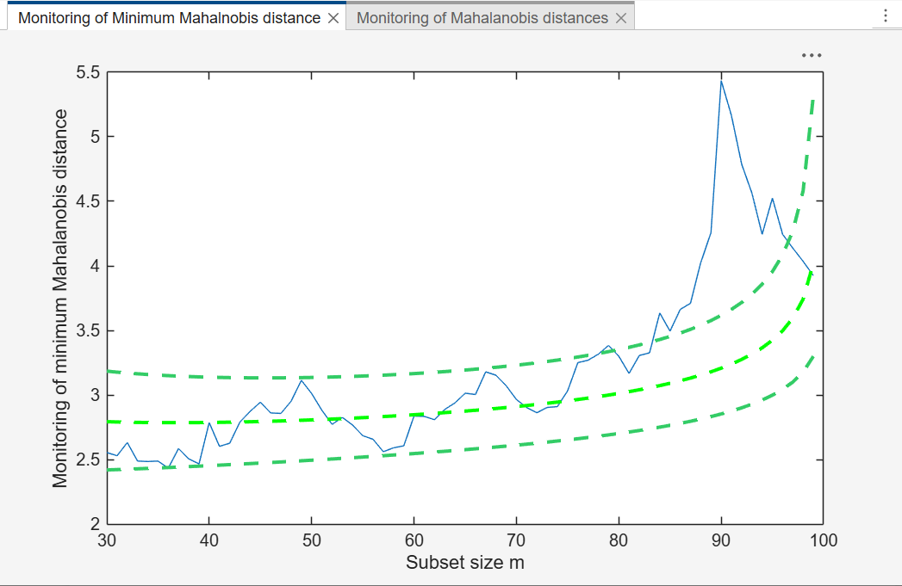
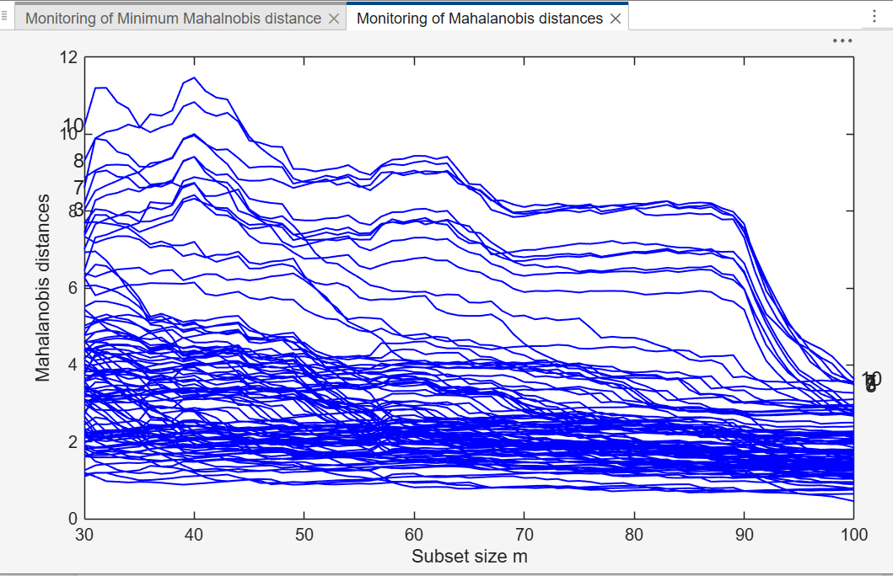

# malfwdplot

malfwdplot plots the trajectories of scaled Mahalanobis distances along the search.

## Input arguments

Mandatory:

| Argument | Type | Description |
|---|---|---|
| `out` | `dict` | structure containing the monitoring of the Mahalanobis distance (fields below) |

Fields of `out`:

| Field | Description |
|---|---|
| `MAL` | `n x k` matrix with the squared Mahalanobis distances monitored in each step of the forward search or, more in general, any other trajectories monitored in `k` steps (e.g. the MCD monitored for `k` different values of break down point, the MM estimators monitored for `k` values of efficiency). It can be created with `FSMeda`, `Smulteda`, `MMmulteda` or `FSCorAnaeda`. Compulsory. |
| `Y` | `n x v` matrix: the original data matrix or another matrix with `n` rows (e.g. the first principal components). Compulsory only if brushing is invoked through the option `databrush`. |
| `Un` | matrix of size `(k-1) x r` with the order of entry of each unit, where `k` is the number of columns of `MAL`. The first column contains the subset size, the other columns the units entered. Not compulsory. |
| `class` | character which specifies how to label the x and y axes and the message in the datatooltip window. If this field is not present, the x label is `'Subset size m'`. Not compulsory. |

Optional, passed as keyword arguments (the most commonly used ones -- see the
full list on RoSA, linked below, for the rest):

| Argument | Default | Description |
|---|---|---|
| `standard` | `SizeAxesNum=10`, `SizeAxesLab=12`, `xlim` and `ylim` automatic, `titl=''`, `labx='Subset size m'`, `laby='Mahalanobis distances'`, `LineWidth=1`, `Color={'b'}`, `LineStyle={'-'}` | `dict` with the appearance of the plot: limits and labels of the axes, font sizes, colour, line width and line style of the trajectories |
| `fground` | `fthresh=2.5`, `flabstep=[m0 n]`, `LineWidth=1`, `LineStyle={'-'}`, `FontSize=12` | `dict` which controls which trajectories are highlighted and how they are plotted. `fthresh`: highlight the units whose MD was at least once greater (in absolute value) than `fthresh`; alternatively `funit` is the list of units to highlight (`fthresh` is then ignored). `flabstep`: steps where labels are put. Other fields: `LineWidth`, `Color`, `LineStyle`, `fmark`, `FontSize`. `fground=''` highlights no unit and puts no label |
| `bground` | `bthresh=2.5` if `n>100`, `-inf` if `n<=100` (all trajectories are treated as important); `bstyle='faint'` when `n>100` | `dict` which specifies the "unimportant" trajectories in background. `bthresh`: units whose MD was always smaller (in absolute value) than `bthresh`. `bstyle`: how to plot them, `'faint'` (colormap), `'hide'` or `'greysh'` (faint grey) |
| `tag` | `'pl_mal'` | tag which identifies the plot; if a plot with the same tag exists, the new plot overwrites it, otherwise a new window is created |
| `label` | `row1, ..., rown` | cell of strings with the labels of the `n` units, used in the datatooltip and in brushing, and to label the units in the plot |
| `nameY` | `Y1, ..., Yv` | cell of strings with the labels of the `v` variables, added to the scatter plot matrix after brushing |
| `msg` | not stated on the FSDA page | `1` saves in `plotopt` the options used to draw the three types of trajectories (`standard`, `fground`, `bground`); `2` also prints them on the screen |
| `conflev` | empty (no confidence line) | confidence levels of the horizontal bands, based on the chi^2 distribution, e.g. `[0.95, 0.99, 0.999]`. The lines are red with line width 2. A `dict` with fields `color`, `linewidth` and `conflev` controls colour and width |

## Example

Monitoring MD plot with all the default options. 

```python
import numpy as np
import pyfsda

eng = pyfsda.start(check_version=False)

state1 = 141243498
np.random.seed(state1)
n = 100
p = 4
Y = np.random.randn(n, p)
Y[0:10, :] = Y[0:10, :] + 4.0

fre = np.asarray(pyfsda.unibiv(Y))
m0 = 20
bs = fre[:m0, 0].reshape(-1, 1)

out = pyfsda.FSMeda(Y, bs, plots=1, init=30)

pyfsda.malfwdplot(out, nargout=0)

eng.render_figures()
eng.wait_for_figures()

pyfsda.stop()
```




## Output

| Output | Description |
|---|---|
| `plotopt` | cell array of strings with the options which have been used to create the plot |

## See also

- malfwdplot documentation: <https://rosa.unipr.it/FSDA/malfwdplot.html>


