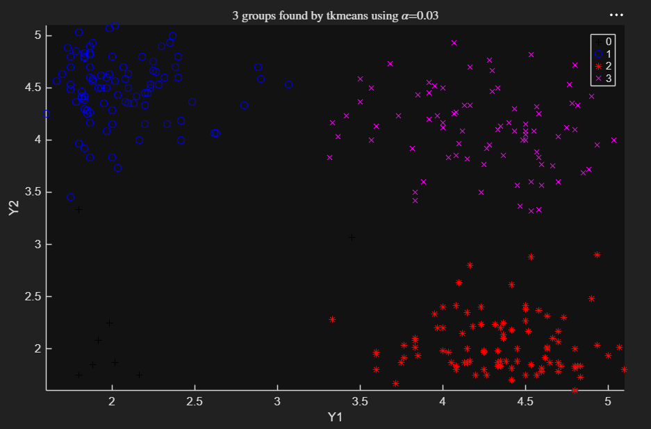

# tkmeans

tkmeans computes trimmed $k$-means clustering.

The algorithm partitions the points in the $n \times v$ data matrix $Y$  into $k$ clusters while trimming a fraction $\alpha$ of the most outlying units. This partition minimizes the trimmed sum, over all clusters, of the within-cluster sums of point-to-cluster-centroid distances. By default, (squared) Euclidean distances are used.

## Input arguments

### Mandatory

| Argument | Type | Description |
|---|---|---|
| `Y` | `ndarray`, `n x v` | Data matrix with $n$ observations and $v$ variables. Rows are observations, columns are variables. Rows containing missing (`NaN`) or infinite (`Inf`) values are excluded automatically from the computations. |
| `k` | `int` | Number of clusters. |
| `alpha` | `float` | Global trimming level, a scalar between $0$ and $0.5$. `alpha = 0` reduces to standard $k$-means. |

### Optional (Keyword Arguments)

| Argument | Default | Description                                                                                                                                                                                                                                                                                                                                                                                                                                                                                                                                                                                                                                                                               |
|---|---|-------------------------------------------------------------------------------------------------------------------------------------------------------------------------------------------------------------------------------------------------------------------------------------------------------------------------------------------------------------------------------------------------------------------------------------------------------------------------------------------------------------------------------------------------------------------------------------------------------------------------------------------------------------------------------------------|
| `nsamp` | `300` | Number of subsamples extracted to find the partition. Set to `0` to extract all possible subsets ($\binom{n}{k}$). If the number of all possible subsets is lower than 300, all of them are extracted by default.                                                                                                                                                                                                                                                                                                                                                                                                                                                                         |
| `refsteps` | `15` | Number of refining iterations performed in each subsample.                                                                                                                                                                                                                                                                                                                                                                                                                                                                                                                                                                                                                                |
| `reftol` | `1e-14` | Tolerance for the refining steps.                                                                                                                                                                                                                                                                                                                                                                                                                                                                                                                                                                                                                                                         |
| `weights` | `0` | Set to `1` to consider cluster weights in the concentration and assignment steps: in the assignment step, $\log n_j$ is subtracted from the squared Euclidean distance of unit $i$ to group $j$. By default no cluster weights are used.                                                                                                                                                                                                                                                                                                                                                                                                                                                  |
| `plots` | `0` | Controls visualization output: `0` (no plot), `1` (classification plot: histogram if $v=1$, bivariate scatterplot if $v=2$, scatterplot matrix if $v>2$). For $v \ge 2$ it can also be `'contourf'` (filled contour in the background, grey levels by default), `'contour'` (contour plot in the background), `'ellipse'` (95% confidence ellipses for each group) or `'boxplotb'` (bivariate boxplots for each group). It can also be a `dict` with the field `type` (one of the previous choices), plus `cmap` (RGB colormap, for `'contour'`/`'contourf'`) or `conflev` (confidence level in $[0, 1]$, for `'ellipse'`). Units with label `0` (trimmed) are excluded from the overlay. |
| `msg` | `1` | If `1`, messages about the estimated computing time are displayed; if `0`, no message is shown.                                                                                                                                                                                                                                                                                                                                                                                                                                                                                                                                                                                           |
| `nocheck` | `0` | Set to `1` to skip input verification checks on `Y`.                                                                                                                                                                                                                                                                                                                                                                                                                                                                                                                                                                                                                                      |
| `nomes` | `0` | Set to `1` to suppress the message about estimated computing time.                                                                                                                                                                                                                                                                                                                                                                                                                                                                                                                                                                                                                        |
| `Ysave` | `0` | Set to `1` to store the input matrix `Y` in the returned dict.                                                                                                                                                                                                                                                                                                                                                                                                                                                                                                                                                                                                                            |

---

## Example

Trimmed $k$-means executed on the geyser2 dataset ($k=3$, $\alpha=0.03$):

```python
import pyfsda

eng = pyfsda.start(check_version=False)

# Load geyser data
Y = pyfsda.load("geyser2.txt")

# Run tkmeans: 3 clusters, 3% trimming
pyfsda.rng(42, nargout=0)
out = pyfsda.tkmeans(Y, 3, 0.03, plots=1)

eng.render_figures()
eng.wait_for_figures()

pyfsda.stop()
```



---

## Output

A `dict` keyed by FSDA structure field names:

| Field | Description                                                                                                                                                                                                                                            |
| --- |--------------------------------------------------------------------------------------------------------------------------------------------------------------------------------------------------------------------------------------------------------|
| `idx` | `n x 1` vector containing the cluster assignment of each unit ($1, \dots, k$). $0$ denotes trimmed observations.                                                                                                                                       |
| `muopt` | `k x v` matrix of final (robust) cluster centroid locations.                                                                                                                                                                                           |
| `sigmaopt` | `v x v x k` array of empirical covariance matrices of the groups found by `tkmeans`.                                                                                                                                                                   |
| `BoxTest` | dict with the results of the Box test of equality of covariance matrices.                                                                                                                                                                              |
| `bs` | `k x 1` vector containing the units forming the initial subset associated with `muopt`.                                                                                                                                                                |
| `D` | `n x k` matrix of squared Euclidean distances from each point to every centroid.                                                                                                                                                                       |
| `siz` | `(k+1) x 3` matrix: 1st column is the sequence $0, \dots, k$; 2nd column is the number of observations in each cluster; 3rd column is the percentage of observations in each cluster. Row `0` denotes trimmed (unassigned) units.                      |
| `weights` | Vector of length $k$ with the cluster weights. If `weights=1`, `weights` $=(1/k, \dots, 1/k)$; otherwise `weights` $=(n_1/n, \dots, n_k/n)$.                                                                                                           |
| `h` | Number of observations that have determined the centroids (number of untrimmed units).                                                                                                                                                                 |
| `obj` | Value of the minimized objective function (value of the best returned solution).                                                                                                                                                                       |
| `Y` | Original data matrix. Present only if `Ysave=1`.                                                                                                                                                                                                       |
| `emp` | "Empirical" statistics computed on the final classification. It is `0` when convergence is reached; otherwise it is a dict with keys `idxemp`, `muemp`, `sigmaemp` and `sizemp`, the empirical counterparts of `idx`, `muopt`, `sigmaopt` and `siz`. |

---

## Notes

The iterative algorithm initializes $k$ clusters randomly and performs concentration steps to improve the current cluster assignment. The maximum number of concentration steps is set by `refsteps`. To approximately reach the global optimum, the procedure is initialized `nsamp` times and concentration steps are run until convergence or until `refsteps` is reached. For more complex datasets, higher values of `nsamp` and `refsteps` may be needed, at the cost of extra computation time. If more than half of the iterations do not converge, a warning is issued suggesting an increase of `nsamp`.

---

## See also

* tkmeans documentation: [https://rosa.unipr.it/FSDA/tkmeans.html](https://rosa.unipr.it/FSDA/tkmeans.html)
* FSDA datasets information: <https://rosa.unipr.it/FSDA/datasets_clu.html>
