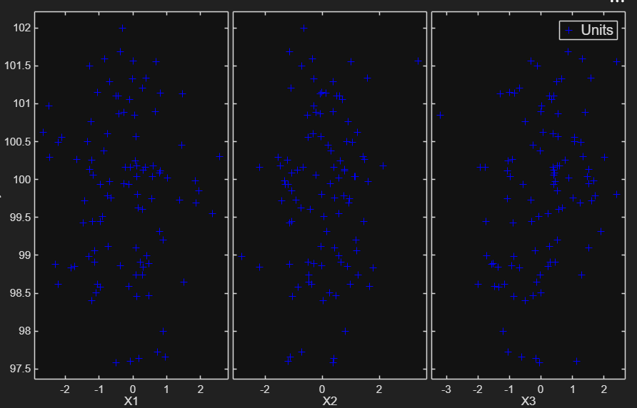

# yXplot

yXplot produces an interactive scatterplot of `y` against each variable of `X` in the input dataset.


## Input arguments

### Mandatory

| Argument | Type | Description                                                                                                                                                                                                                                                                                              |
|---|---|----------------------------------------------------------------------------------------------------------------------------------------------------------------------------------------------------------------------------------------------------------------------------------------------------------|
| `y` | `ndarray`, length `n`, or `dict` | Response variable (vector with $n$ elements, or table with one column), or a dict containing monitoring information and possibly other fields to link with monitoring plots (see below).                                                                                                                 |
| `X` | `ndarray`, `n x p`, or table | Matrix of explanatory variables (regressors). Rows are observations, columns are variables. If `X` is a table, its columns can contain both numeric and categorical variables; categorical variables are transformed into numeric and jittered with `randn`. Not needed if the first argument is a dict. |

**If `y` is a vector**, the remaining arguments can be either a sequence of name/value pairs or one of the explicit forms:

```python
pyfsda.yXplot(y, X, group)
pyfsda.yXplot(y, X, group, plo)
pyfsda.yXplot(y, X, name1=value1, name2=value2, ...)
```

If the third argument is a vector with $n$ elements, it is interpreted as the grouping variable `group`; in this case it can only be followed by `plo`. Otherwise the function expects name/value pairs.

**If `y` is a dict**, the following fields are required:

| Field | Description |
|---|---|
| `y` | Vector of length $n$ containing the response. |
| `X` | `n x p` matrix of explanatory variables. |

With only these fields a standard static yXplot is created. To enable dynamic brushing and linking with the forward search plots, the dict must also contain:

| Field | Description                                                                                                                                                                                                                                                                                             |
|---|---------------------------------------------------------------------------------------------------------------------------------------------------------------------------------------------------------------------------------------------------------------------------------------------------------|
| `RES` | Matrix containing the residuals monitored at each step of the forward search; each row is associated with a unit. It can be created with `FSReda` (compulsory).                                                                                                                                         |
| `Un` | Matrix containing the order of entry of each unit (necessary if `datatooltip` is set or `databrush` is not empty).                                                                                                                                                                                      |
| `label` | Optional list of length $n$ with the labels of the units, used together with `databrush` and `datatooltip`. If absent with `datatooltip=1`, labels `row1, ..., rown` are created automatically. With `databrush` and `labeladd='1'`, the trajectories in the resfwdplot are labelled with `y['label']`. |

The structure above is generated automatically by `FSReda`.

### Optional (Keyword Arguments)

| Argument | Default                                   | Description                                                                                                                                                                                                                                                                                                                                                                                                                                                                       |
|---|-------------------------------------------|-----------------------------------------------------------------------------------------------------------------------------------------------------------------------------------------------------------------------------------------------------------------------------------------------------------------------------------------------------------------------------------------------------------------------------------------------------------------------------------|
| `group` | none                                      | Grouping variable determining the marker and color of each point. Can be a categorical, numeric or logical vector, character or string array, or list of strings. If `group` is used to separate outliers from good units, the id of the outliers should be the larger one.                                                                                                                                                                                                       |
| `plo` | `[]`                                      | Plot personalization. `[]`: no names or labels are added. `1`: the names `y`, `X1`, ..., `Xp` are added to the margins of the scatterplot matrix. Or a `dict` with the keys listed in the table below.                                                                                                                                                                                                                                                                            |
| `tag` | `'pl_yX'`                                 | String identifying the handle of the plot being created. If a plot with the same tag already exists, the new plot overwrites it in the same window; otherwise a new window is created.                                                                                                                                                                                                                                                                                            |
| `nameX` | `X1, ..., Xp`                             | List of strings of length $p$ with the names of the explanatory variables.                                                                                                                                                                                                                                                                                                                                                                                                        |
| `namey` | none                                      | Label of the response variable.                                                                                                                                                                                                                                                                                                                                                                                                                                                   |
| `xlimx` | automatic                                 | Vector with two elements: minimum and maximum of the x axes.                                                                                                                                                                                                                                                                                                                                                                                                                      |
| `ylimy` | automatic                                 | Vector with two elements: minimum and maximum of the y axis.                                                                                                                                                                                                                                                                                                                                                                                                                      |
| `datatooltip` | `''`                                      | Personalized tooltip. Can be used only if `y` is a dict. If not empty, clicking on a point shows the unit selected, the step in which it enters the search and its label. It can be a `dict` with keys `DisplayStyle` and `SnapToDataVertex` (defaults `'Window'` and `'on'`).                                                                                                                                                                                                    |
| `databrush` | `''`                                      | Interactive brushing. Can be used only if `y` is a dict. Brushed units are highlighted in the resfwdplot (created automatically if it does not exist) and, if already open, in the other forward search monitoring plots. A scalar selects a rectangular brush, usable only once. A list accepts all the optional arguments of `selectdataFS` plus `persist`, `bivarfit`, `multivarfit` and `labeladd` (see below).                                                               |
| `subsize` | see description                           | Numeric vector with the subset sizes (length equal to the number of columns of the residual matrix). Default: `size(residuals,1)-size(residuals,2)+1:size(residuals,1)`. Usable only if `databrush` is not empty; it acts on the monitoring residuals plot.                                                                                                                                                                                                                       |
| `selstep` | `[m0 n]`                                  | Steps of the forward search at which text labels are added in the monitoring residuals plot after brushing. Default is the initial and final step of the search. Usable only if `databrush` is not empty.                                                                                                                                                                                                                                                                         |
| `selunit` | `'2.5'` if `y` is a dict, empty otherwise | Unit labelling in the yXplot and in the associated resfwdplot. A list of strings `['lo', 'hi']` labels the units that in at least one step had a residual smaller than `lo` or greater than `hi`. A string (e.g. `'2.6'`) is a threshold on the absolute scaled residual (or on the value of the response if `y` is a vector). A numeric vector lists the units to label in each panel. Labels come from `y['label']` (dict) or `plo['label']` (vector), otherwise `1:n` is used. |

#### Fields of `plo` (when it is a `dict`)

| Field | Description                                                                                                                                                                              |
|---|------------------------------------------------------------------------------------------------------------------------------------------------------------------------------------------|
| `labeladd` | If `'1'`, the elements belonging to `max(group)` are labelled with their unit row index. Default `''`: no label added.                                                                   |
| `clr` | String of color specifications. Default `'brkmgcy'`.                                                                                                                                     |
| `sym` | String or list of marker specifications, e.g. `'o+x'` or `['o', '+', 'x']`. Default sequence: `'+'`, `'o'`, `'*'`, `'x'`, `'s'`, `'d'`, `'^'`, `'v'`, `'>'`, `'<'`, `'p'`, `'h'`, `'.'`. |
| `siz` | Scalar marker size used for all plots. Default `''`: depends on the number of plots and on the figure size.                                                                              |
| `doleg` | `'on'` (default) or `'off'`: whether legends are created.                                                                                                                                |
| `nameX` | Names of the explanatory variables (same as the `nameX` option).                                                                                                                         |
| `namey` | Name of the response variable (same as the `namey` option).                                                                                                                              |
| `ylimy` | y limits (same as the `ylimy` option).                                                                                                                                                   |
| `xlimx` | x limits (same as the `xlimx` option).                                                                                                                                                   |
| `label` | List of length $n$ with the labels of the units. If empty, `1:n` is used.                                                                                                                |

#### Options of `databrush` (when it is a list)

| Option | Description                                                                                                                                                                                                                                                                                                                                                                                                      |
|---|------------------------------------------------------------------------------------------------------------------------------------------------------------------------------------------------------------------------------------------------------------------------------------------------------------------------------------------------------------------------------------------------------------------|
| `persist` | `''` (default): brushing is allowed only once. `'on'`: brushing can be repeated and the units currently brushed are added to those previously brushed (a different color can be used for each brush). `'off'`: brushing can be repeated, and each new brush removes the units previously brushed.                                                                                                                |
| `bivarfit` | Adds least squares lines to the plots of `y\|X`. `''` (default): no line. `'1'`: one OLS line for all points of each bivariate plot. `'2'`: two lines, one for all points and one for the last selected group (useful with a set of potential outliers). `'0'`: one line for each selected group (useful for mixtures of regression lines). `'i1'`, `'i2'`, ...: a line for the group with index `i` = 1, 2, ... |
| `multivarfit` | If `'1'`, a line based on the fitted hyperplane coefficients is added to each scatter plot: $\bar{y} + C_i X_i$, where $C_i$ is the coefficient of $X_i$. Default `''`: no line.                                                                                                                                                                                                                                 |
| `labeladd` | If `'1'`, the units of the last selected group are labelled with the unit row index (if `y` is a vector) or with `y['label']` (if `y` is a dict). Default `''`.                                                                                                                                                                                                                                                  |

---

## Example

Scatterplot of `y` against each variable of `X` with all the default options:

```python
import numpy as np
import pyfsda

eng = pyfsda.start(check_version=False)

# Generate data (n=100, p=3)
np.random.seed(123456)
n = 100
p = 3
X = np.random.randn(n, p)
y = 100 + np.random.randn(n, 1)

# yXplot with all the default options
pyfsda.yXplot(y, X)

eng.render_figures()
eng.wait_for_figures()

pyfsda.stop()
```




---

## Output

`yXplot` has the same outputs as `gplotmatrix` of the MATLAB Statistics Toolbox:

| Output | Description |
| --- | --- |
| `H` | 3D array of handles to the plotted points. The third dimension corresponds to the groups. |
| `AX` | Matrix of handles to the individual subaxes. It contains one extra row of handles to invisible axes in which the histograms are plotted. |
| `BigAx` | Handle to the big (invisible) axes framing the subaxes. It is left as the current axes, so a subsequent title, xlabel or ylabel is centered with respect to the matrix of axes. |

---

## See also

* yXplot documentation: [https://rosa.unipr.it/FSDA/yXplot.html](https://rosa.unipr.it/FSDA/yXplot.html)